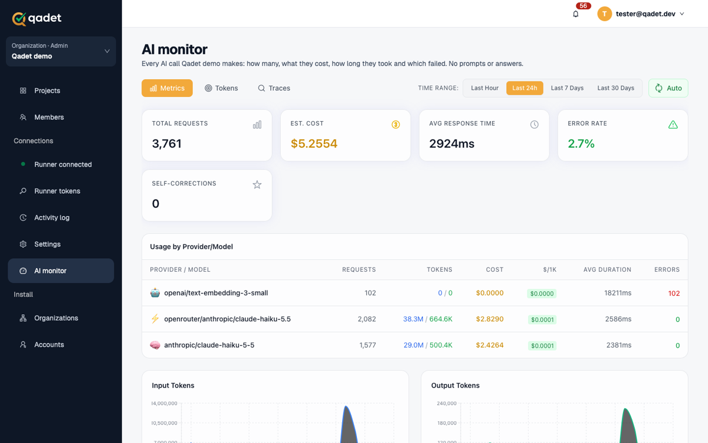
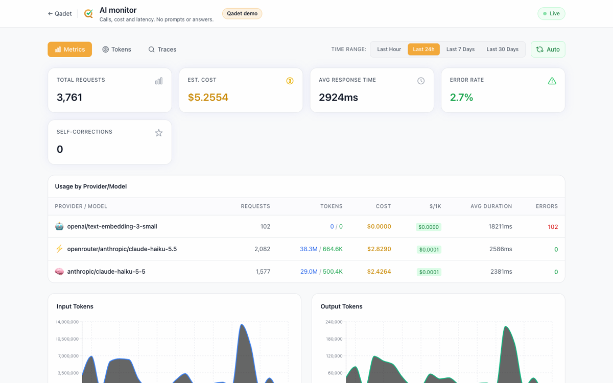

# Fit the dashboard into your app

NodeLLM Monitor's dashboard can look and sit like a page of your own app: your name, logo and colors, a label for the tenant it shows, and, with embedded mode, inside your app's own layout with no second header.



_Qadet shows each organization's AI monitor inside its own page: its sidebar and header, then the dashboard._

- [The `ui` option](#the-ui-option)
- [Embedded mode: inside your own page](#embedded-mode-inside-your-own-page)
- [Serving the build from another stack](#serving-the-build-from-another-stack)
- [Security checklist](#security-checklist)
- [One dashboard per tenant](#one-dashboard-per-tenant)
- [Example: Qadet](#example-qadet)

## The `ui` option

```ts
import { createMonitorMiddleware } from "@node-llm/monitor/ui";

app.use(
  createMonitorMiddleware(store, {
    basePath: "/admin/monitor",
    ui: {
      title: "AI monitor",
      subtitle: "Calls, cost and latency",
      logoUrl: "/logo.svg",
      accentColor: "#f2a93b",
      theme: "light",
      context: "Acme Inc.",
      backLink: { label: "Back to app", href: "/" },
      hideGithubLink: true,
      hideLanguageSwitcher: true,
      hideFooter: true,
      documentTitle: "AI monitor · Acme Inc.",
      embedded: false
    }
  })
);
```

| Option | What it does |
| --- | --- |
| `title`, `subtitle` | Header text. Defaults: "NodeLLM Monitor" and its tagline (or your i18n title). |
| `logoUrl` | An image shown in place of the NodeLLM Monitor mark. |
| `accentColor` | A hex color for buttons, tabs and highlights. Opacity shades follow it. |
| `theme` | `"light"`, `"dark"` or `"system"` (default). |
| `context` | A badge in the header naming what's shown, such as a tenant or environment. |
| `backLink` | `{ label, href }`: a link back to your app at the start of the header. |
| `hideGithubLink`, `hideLanguageSwitcher`, `hideFooter` | Hide the dashboard's own extras. |
| `documentTitle` | The browser tab title. Default: `title`. |
| `embedded` | Show the dashboard inside your own page. See below. |

Without `ui`, the dashboard looks as it always has.



_The same dashboard on its own page, branded with `ui`: Qadet's logo and accent, the organization as a badge, and a link back._

## Embedded mode: inside your own page

With `embedded: true` the dashboard drops its header, footer and page background, and tells the page around it how tall it is, so you can show it in a frame of your own page with a single scrollbar.

1. **Serve the dashboard with `embedded: true`.** Hosts usually keep both: the standalone page, and an embedded variant for the frame, such as `?embedded=1`.

2. **Show it in a same-origin frame, and size the frame from its height message.** Accept the message only from your own origin and from that frame:

   ```tsx
   const frame = useRef<HTMLIFrameElement>(null);
   const [height, setHeight] = useState(900);

   useEffect(() => {
     const onMessage = (event: MessageEvent) => {
       if (event.origin !== window.location.origin) return;
       if (event.source !== frame.current?.contentWindow) return;
       const { type, height } = event.data ?? {};
       if (type !== "nodellm-monitor:height" || typeof height !== "number") return;
       setHeight(Math.min(Math.max(Math.ceil(height), 400), 20000));
     };
     window.addEventListener("message", onMessage);
     return () => window.removeEventListener("message", onMessage);
   }, []);

   return (
     <iframe
       ref={frame}
       src="/admin/monitor/?embedded=1"
       title="AI monitor"
       referrerPolicy="same-origin"
       style={{ width: "100%", height, border: 0 }}
     />
   );
   ```

   The dashboard posts `{ type: "nodellm-monitor:height", height }` to its own origin only (`postMessage(…, location.origin)`), so no other site can receive it.

3. **Allow the dashboard page, and only it, to be framed by your own site.** See the checklist.

## Serving the build from another stack

The dashboard is a static build (`dashboard/build` in the package) that calls `./api/*` relative to itself. Rails, Django or any other app can serve it and answer that API from its own data:

| Endpoint | Returns |
| --- | --- |
| `GET ./api/stats?from=` | `MonitoringStats` |
| `GET ./api/metrics?from=` | `MetricsData` |
| `GET ./api/traces?limit=&offset=&status=&model=&provider=&query=&from=` | `PaginatedTraces` |
| `GET ./api/events?requestId=` | `MonitoringEvent[]` |

Serve the page from a path ending in `/`, so its relative paths resolve. Pass the `ui` options as `window.__MONITOR_UI__` in a script before the dashboard's own. In Node, `injectDashboardConfig(html, { ui })` from `@node-llm/monitor/ui` does this, escaping values so they can't end the script. Elsewhere, JSON-encode the object with your framework's script-safe escaping, such as Rails' `ERB::Util.json_escape`. With a Content Security Policy, give that script your nonce.

## Security checklist

Embedding adds no new trust: the dashboard is your own page, on your own origin, behind your own sign-in.

- **Frame it only from your own site.** Send `Content-Security-Policy: frame-ancestors 'self'` and `X-Frame-Options: SAMEORIGIN` on the dashboard page alone. Keep `frame-ancestors 'none'` everywhere else, so no other page of your app can be framed (clickjacking).
- **Leave the JSON API unframeable.** It's fetched, never framed, so it keeps your default headers.
- **Check every message.** Accept the height message only when `event.origin` is your own and `event.source` is the dashboard's frame, and clamp the number.
- **Don't add `sandbox`.** A same-origin page that needs your sign-in cookie must keep `allow-same-origin` and `allow-scripts`, and together they make `sandbox` no protection. The safeguard is the `frame-ancestors` rule above.
- **Use a nonce for the injected settings script** under a CSP with `script-src` nonces.
- **Escape every host value** you inject, such as a tenant's name in `context`.
- **Pin the dashboard version.** It runs on your origin, so treat upgrades like any dependency.

## One dashboard per tenant

For multi-tenant apps, give each tenant its own view rather than one dashboard over everyone:

- Scope the store, or your own API, to the signed-in tenant. A request for another tenant's call returns nothing.
- Name the tenant with `context`, so it's clear whose calls these are.
- Decide per tenant whether content (prompts and answers) is shown. `captureContent: false` keeps it out of the store entirely. A host that keeps content for its own reasons can still leave it out of the API.

## Example: Qadet

[Qadet](https://qadet.nodellm.dev), an AI QA engineer, gives each organization's admins its own AI monitor, covering both its NodeLLM runner and its RubyLLM web app.

- **Rails serves the build** and answers `./api/*` from its own call records, scoped to the current organization.
- **An organization chooses** Off, Calls only, or Calls and content. With content, each look at a call's prompt and answer is written to its audit log.
- **The `ui` options** carry Qadet's logo, saffron accent and light theme, the organization as `context`, a back link, and the extras hidden. A Rails nonce covers the injected script.
- **Qadet's own `/monitor` page** frames the `?embedded=1` variant. Only that page allows `frame-ancestors 'self'`; every other Qadet page keeps `'none'`.
